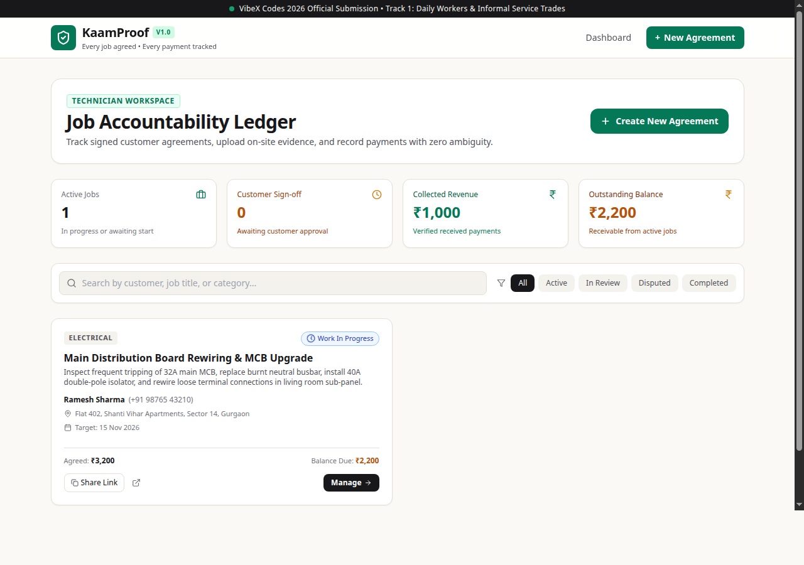
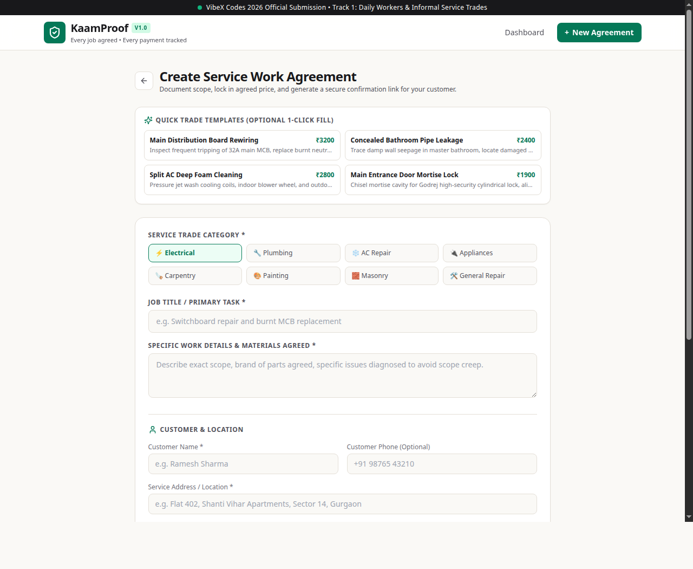
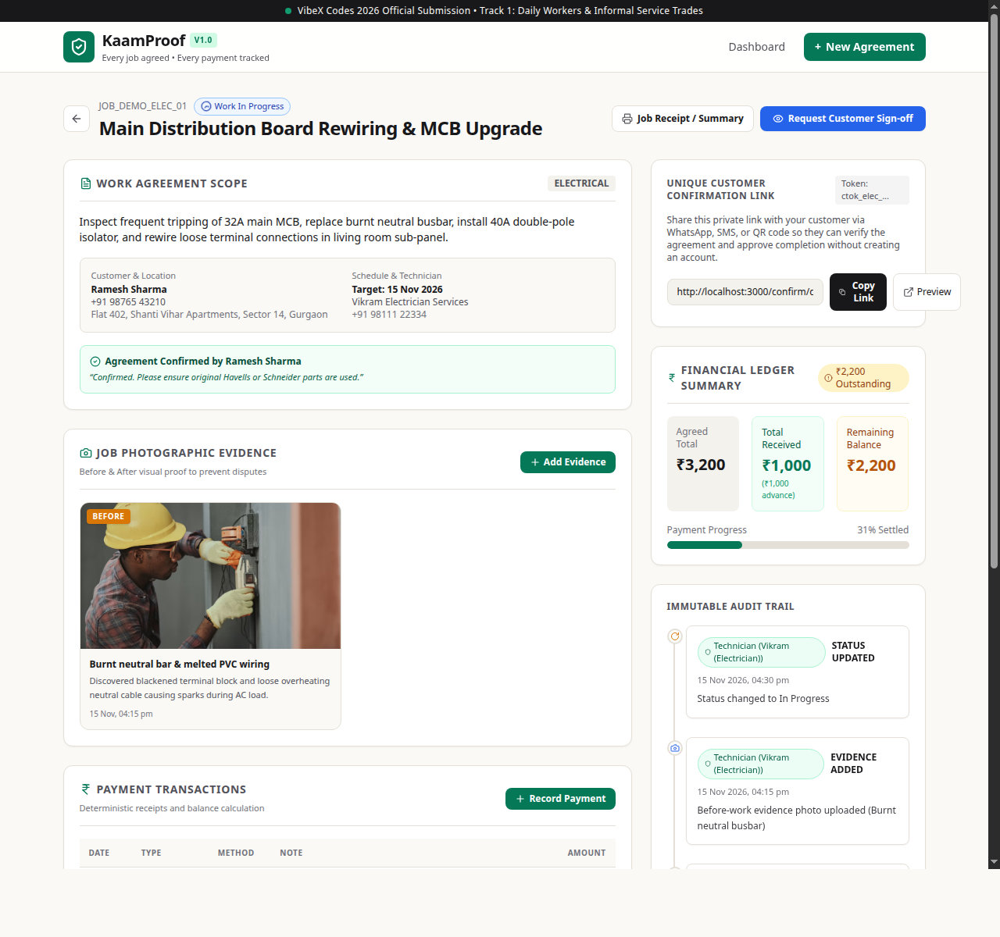
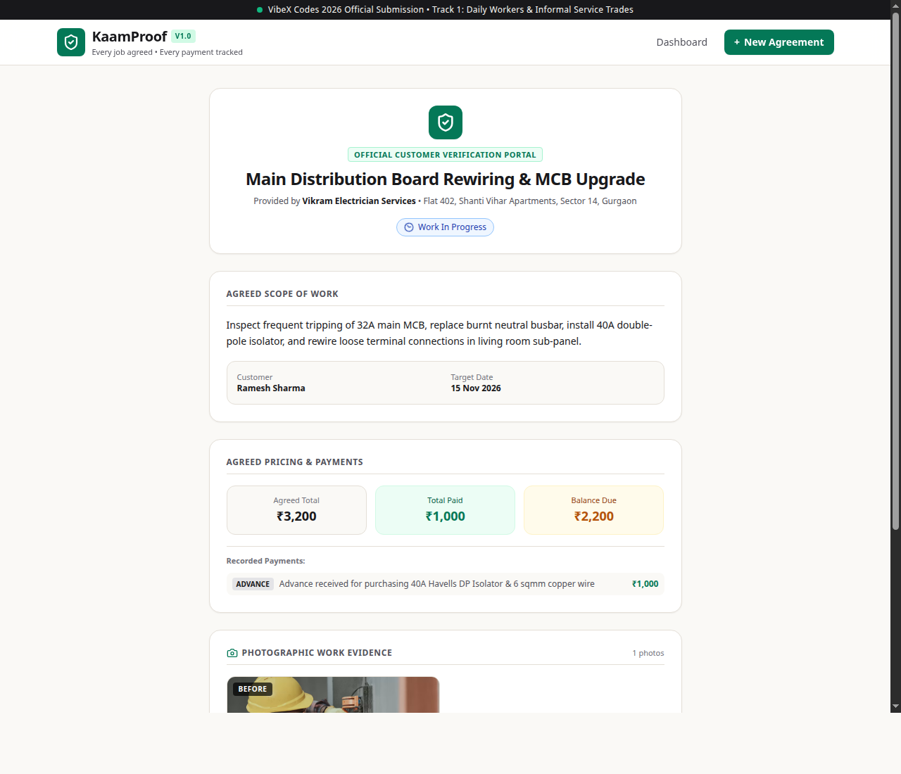
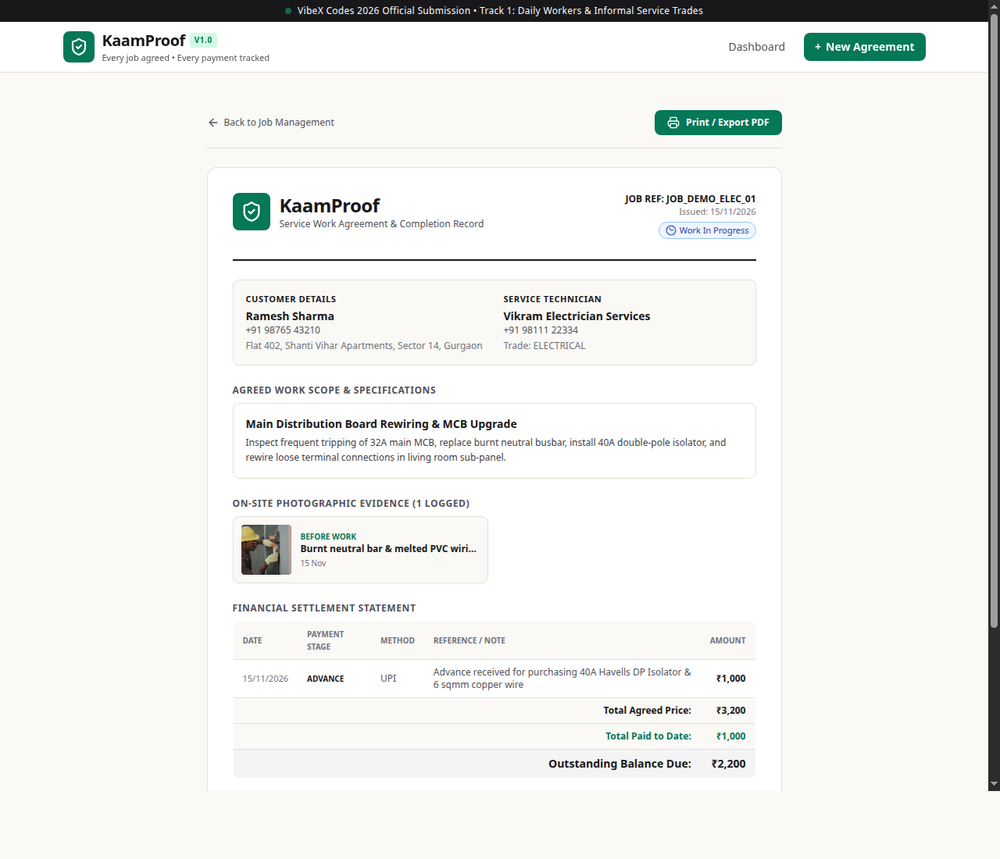

# KaamProof (कामप्रूफ)

> **Zero-Friction Service-Job Accountability Protocol & Deterministic Payment Ledger for India's Informal Workforce**  
> *VibeX Codes 2026 — Track 1: Daily Workers, Small Shopkeepers & Informal Workforce*

[](https://github.com/JamalpureNikhil6/KaamProof)
[](https://nextjs.org)
[](https://www.typescriptlang.org)
[](scripts/test-runner.js)
[](src/app/globals.css)

---

## ⚡ The Problem: Verbal Chaos in Informal Trades

Millions of electricians, plumbers, carpenters, mechanics, and AC technicians in India conduct **95%+ of their business verbally or through fragmented WhatsApp calls**. 

Over **30% of informal jobs suffer payment delays, disputes, or broken trust** due to four universal failure points:
1. **Ambiguous Verbal Scope:** Customers dispute parts quality or claim additional unquoted work was promised.
2. **Unrecorded Cash/UPI Advances:** Technicians collect ₹500–₹2,000 upfront for materials, but customers contest the advance amount during final settlement.
3. **Hidden / Concealed Repairs:** Homeowners cannot see work done inside switchboards, concealed walls, or motor bearings, breeding skepticism (*"Did you actually replace the wire?"*).
4. **Unilateral Payment Withholding:** Disgruntled customers hold back entire payments with no formal dispute mechanism or documented evidence.

### Why KaamProof is NOT a Gig Marketplace
Existing platforms (like Urban Company) act as middlemen: they charge 20–30% commissions, dictate pricing, and commoditize technicians. **KaamProof is not a marketplace.** It is an **accountability tool for the independent tradesperson** to protect their existing clients, lock agreed pricing, verify before/after work, and guarantee zero payment ambiguity.

---

## 🛡️ The KaamProof 4-Step Protocol

```
┌─────────────────────────────────┐
│ 1. 30-Second Work Agreement     │
│    • Trade scope & parts        │
│    • Locked price & UPI advance │
└────────────────┬────────────────┘
                 │
                 ▼
┌─────────────────────────────────┐
│ 2. Scoped Customer Link         │
│    • Sent via WhatsApp / SMS    │
│    • Zero app download / signup │
│    • Customer clicks "Accept"   │
└────────────────┬────────────────┘
                 │
                 ▼
┌─────────────────────────────────┐
│ 3. On-Site Evidence Trail       │
│    • Before & After photos      │
│    • Direct multipart upload    │
│    • Timestamped audit notes    │
└────────────────┬────────────────┘
                 │
                 ▼
┌─────────────────────────────────┐
│ 4. Deterministic Settlement     │
│    • Customer signs off work    │
│    • Balance tracked to ₹0      │
│    • Printable job certificate  │
└─────────────────────────────────┘
```

---

## 📸 Real Application Screens

### 1. Technician Workspace & Financial Overview
*Track active jobs, pending sign-offs, total collected revenue, and outstanding balance at a glance.*


### 2. Fast Agreement Creation with Trade Templates
*1-click presets for Electrical, Plumbing, AC Repair, and Carpentry with advance payment tracking.*


### 3. Technician Job Management Ledger
*Real-time before/after photo gallery, payment transaction ledger, and immutable chronological audit trail.*


### 4. Zero-Login Customer Confirmation Portal
*Private cryptographic link (`/confirm/[token]`) where customers inspect scope, review photos, approve completion, or register a formal dispute.*


### 5. Printable Service Certificate & Job Receipt
*Formal paper-ready certificate with full financial settlement statement and dual digital verification hashes.*


---

## 🔒 Architectural Discipline & Security Invariants

* **Deterministic Financial Math:** Currency (INR ₹) calculated strictly to 2 decimal places using `Math.round(amount * 100) / 100`. Eliminates floating-point rounding drift across multi-stage advances, interim payments, and settlements.
* **Non-Auto-Approving Dispute Safeguard:** If a customer raises a disagreement, the job immediately enters `disputed` status with a mandatory dispute reason. The engine **never** auto-completes disputed work.
* **Scoped Cryptographic Tokens:** Customer portals use 29-character unguessable tokens (`ctok_${crypto.randomBytes(12)}`). Token-holders can only confirm their specific agreement and review completion; they cannot modify rates, delete jobs, or access administrative worker settings.
* **Immutable Chronological Audit Trail:** Every status jump, payment receipt, and evidence upload automatically appends a timestamped `ActivityEvent` tagged by actor (`worker`, `customer`, `system`).
* **Direct Multipart Image Uploads:** On-site photo capture backed by `/api/upload` storing evidence locally with unique content hashing and fallback to cloud URLs.

---

## 🧪 Verification & Test Suite

All 27 core engine invariants, financial calculations, state transitions, and security boundaries are validated automatically.

```bash
$ npm test

=========================================
   KAAMPROOF CORE ENGINE TEST SUITE      
=========================================

--- TEST GROUP 1: Deterministic Financials & Floating Point Precision ---
✅ PASS: Agreed price matches expected
✅ PASS: Total paid deterministic calculation (Expected 4500.50, got 4500.5)
✅ PASS: Balance due is exactly 0.00 (Got 0)
✅ PASS: isFullyPaid flag is correctly true when balance is 0
✅ PASS: Advance paid correctly isolated

--- TEST GROUP 2: Partial Balance Verification ---
✅ PASS: Balance due after ₹1000 advance is ₹2200 (Got ₹2200)
✅ PASS: Job is marked not fully paid

--- TEST GROUP 3: Job Lifecycle State Machine ---
✅ PASS: Can confirm from pending_customer_confirm
✅ PASS: Can reject from pending_customer_confirm
✅ PASS: Can start work once confirmed
✅ PASS: Can request customer completion review
✅ PASS: Customer can approve completion
✅ PASS: Customer can dispute completion
✅ PASS: Illegal transition directly to closed is blocked

--- TEST GROUP 4: Disputed Job Safety Invariant ---
✅ PASS: Job transitioned to 'disputed' upon customer objection
✅ PASS: Disputed job is never automatically approved

--- TEST GROUP 5: Security & Token Randomness ---
✅ PASS: Token length is safe and uniform (Length: 29)
✅ PASS: Unique non-deterministic tokens generated
✅ PASS: Customer token has recognizable prefix

--- TEST GROUP 6: Persistence & Seed Verification ---
✅ PASS: Database file exists at /data/jobs.json
✅ PASS: Database contains valid array of jobs
✅ PASS: Seed job loaded successfully (Found 5 jobs)
✅ PASS: Seed job exists in database
✅ PASS: Electrician demo seed job id matches
✅ PASS: Seed customer token valid
✅ PASS: Seed job contains initial payment
✅ PASS: Seed job contains full audit trail

=========================================
TEST SUMMARY: 27 passed, 0 failed.
=========================================
```

### Production Build Validation
```bash
$ npm run build
✓ Compiled successfully
✓ Linting and checking validity of types
✓ Generating static pages (7/7)
✓ Finalizing page optimization
Exit code: 0
```

---

## 🚀 Quickstart & Local Setup

### 1. Prerequisites
- Node.js 18.x or 20.x
- npm 9.x+

### 2. Installation
```bash
# Clone the repository
git clone https://github.com/JamalpureNikhil6/KaamProof.git
cd KaamProof

# Install dependencies
npm install
```

### 3. Run Automated Tests
```bash
npm test
```

### 4. Start Development Server
```bash
npm run dev
# Open http://localhost:3000 in your browser
```

### 5. Production Build & Start
```bash
npm run build
npm run start
```

---

## 📁 Repository Structure

```
KaamProff/
├── data/
│   └── jobs.json                 # Atomic JSON persistent database
├── docs/
│   ├── SPEC-kaamproof.md         # Technical capability specification & state machine
│   ├── QA_SECURITY_REPORT.md     # Security audit & invariant verification report
│   └── DEMO_SCRIPT.md            # Timed 2.5-minute presenter demo script
├── public/
│   ├── images/                   # Real application screenshots for GitHub & presentation
│   └── uploads/                  # Local on-site photo evidence storage
├── scripts/
│   ├── seed-db.js                # Database seeder (Electrician Switchboard scenario)
│   └── test-runner.js            # Automated 27-test validation suite
├── src/
│   ├── app/
│   │   ├── api/                  # REST APIs (jobs, status, evidence, payments, upload)
│   │   ├── confirm/[token]/      # Zero-login customer verification portal
│   │   ├── jobs/                 # Worker dashboard, job wizard, detail view, print receipt
│   │   └── globals.css           # Warm editorial theme & typography styles
│   ├── components/               # StatusBadge, Timeline, FinancialSummaryCard, CopyLinkButton
│   └── lib/                      # Shared types contract, storage engine, jobs service
└── submission/
    ├── PROJECT_MONITOR.md        # Continuous QA & workflow audit tracker
    ├── PPT_CONTENT_DRAFT.md      # 7-slide competition presentation deck content
    ├── SCREENSHOT_CHECKLIST.md   # Screenshot resolution, locations & verification log
    └── SUBMISSION_READINESS.md   # Final hackathon submission audit report
```

---

## 🏆 VibeX Codes 2026 Submission

* **Track:** Track 1 — Daily Workers, Small Shopkeepers & Informal Workforce
* **Core Scenario:** Electrician switchboard inspection, MCB replacement, ₹1,000 UPI advance tracking, before/after burnt busbar proof, customer sign-off, and ₹2,200 final balance settlement.
* **License:** MIT License

